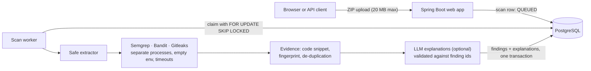

# CG: code security scanning with explained findings


Upload a ZIP of source code; CG runs **Semgrep, Bandit and Gitleaks** on it, shows every finding with the code it points at, and adds a plain-English explanation and fix from an LLM. Scanner output and AI output are stored and displayed separately: the scanners decide what is a finding, the LLM only explains.

**Live demo:** https://cg-5pfq.onrender.com (free tier: after 15 idle minutes it sleeps, and the first visit takes 2–3 minutes to wake it) · **API docs:** `/swagger-ui.html`

Java 21 · Spring Boot 4 · Spring Security (JWT + session) · PostgreSQL · Flyway · Thymeleaf · Testcontainers · Docker · GitHub Actions

## How it works



1. The upload is streamed to disk with a hard 20 MB stop and a ZIP signature check, then queued. The request returns `202` immediately.
2. A worker claims the oldest queued scan with `SELECT … FOR UPDATE SKIP LOCKED`, so two workers can never take the same scan. It sends a heartbeat every 10 s; a scan whose worker died is retried after 60 s, at most 3 times.
3. The archive is checked entry by entry before anything is written, then the three scanners run on the extracted folder.
4. Each finding keeps its code snippet (files are deleted after the scan) and a fingerprint. The most severe finding wins when two tools flag the same line.
5. If an LLM key is configured, the top findings are explained. Findings and explanations are saved in one transaction, so a scan is never half-finished.

## Security design

Uploaded code and LLM output are both treated as untrusted. Each rule below is enforced in code; the tests cover the archive, process, access-control, rate-limit, CSRF/CSP and LLM-validation rules.

| Threat | What CG does |
|---|---|
| Zip Slip (`../`, absolute paths, drive letters, backslashes) | Every entry name is checked, and the resolved path must stay inside the extraction folder |
| Symlinks in the archive | Rejected (`archive_contains_symlink`) |
| Zip bombs | Per-entry compression-ratio limit, and bytes actually written are counted because ZIP headers can lie |
| Too many files, oversize uploads | 5,000 entries, 100 MB extracted, 20 MB upload, counted while streaming |
| Running uploaded code | Never happens: scanners only read files |
| Secrets leaking to scanners | Each scanner gets an argument list (no shell) and an empty environment except `PATH`, `HOME` and the locale |
| Runaway scanners | 120 s timeout per tool; on timeout its child processes are killed too (Semgrep runs `semgrep-core` as a child) |
| Argument injection via file names | Scanners are given the folder (`.`), never a list of uploaded names |
| LLM inventing or hiding findings | It sees findings by short id; unknown, duplicate or empty items are dropped. "Likely false positive" is a label, never a deletion |
| Prompt injection in uploaded code | Code is marked as untrusted data in the prompt, and the reply is validated, not trusted |
| Secrets sent to the LLM or stored | Gitleaks findings are stored and sent as `[secret redacted]`; their fingerprint uses the position, not the line |
| Users reading each other's scans | Every query is scoped to the caller's id; another user's scan returns `404`, not `403` |
| Password guessing | 5 wrong passwords per email per 15 minutes, shared by the API and the dashboard |
| CSRF, clickjacking, XSS on the dashboard | CSRF tokens on every form, `frame-ancestors 'none'`, a strict Content-Security-Policy with no inline scripts or styles |
| Supply chain | CI actions pinned to commit SHAs, Gitleaks download checked against its published checksum, Dependabot for updates |
| Container | Runs as a non-root user; the build fails if any scanner is broken |

## Example

Scanning a five-line file with a SQL injection and `shell=True`:

| Severity | Line | Scanner | AI explanation |
|---|---|---|---|
| HIGH | 3 | semgrep, raw SQL query | Use a parameterised query: `execute('… WHERE name = ?', (name,))` |
| HIGH | 5 | semgrep, `subprocess-shell-true` | Pass the command as a list, without a shell |
| LOW | 1 | bandit B404, subprocess import | Marked *likely false positive*: importing alone isn't a risk. Still shown |

Scanning a real 13-file project (an earlier version of this tool) found GitHub Actions pinned to mutable tags, and a `subprocess` call that led to an argument-injection bug: file names from pull requests were passed straight to the scanners, so a file named `--config=…` would have been read as an option. CG avoids that class of bug by design.

## Run it locally

Requirements: Java 21, Docker.

```bash
# secrets for local runs (git-ignored); .env.properties.example lists every setting
cp .env.properties.example .env.properties
# then set cg.jwt.secret to the output of: openssl rand -base64 48
# and optionally cg.llm.api-key to a Groq key

# the full stack, exactly as in production (512 MB memory limit)
docker compose --profile app up --build
```

Open http://localhost:8080, create an account (password: 12+ characters) and upload a ZIP.

For development: `docker compose up -d db`, then `./mvnw spring-boot:run`. This needs `semgrep`, `bandit` and `gitleaks` on your PATH (`pipx install semgrep bandit`, and Gitleaks from its releases page).

## Tests

```bash
./mvnw verify
```

52 tests; everything touching the database runs against a real PostgreSQL via Testcontainers:
- the archive validator against crafted malicious ZIPs;
- the job queue, including two workers competing for scans and retries after a crash;
- the real scanners on a known-vulnerable file, and scanner processes (timeouts, no leaked environment);
- the LLM guardrails, using a fake model;
- the REST API and the dashboard over real HTTP, including CSRF, cross-user access and rate limits.

CI runs all of them on every push, fails if the real-scanner test was skipped, and builds the Docker image.

## Evaluation

`eval/run_eval.py` uploads 22 labelled Python samples (12 with one known vulnerability, 10 safe lookalikes) through the real API and scores the result: recall, precision and false-positive rate for the scanners alone and with the LLM's false-positive labels, plus invalid line references, duplicates, scan time and LLM label consistency across runs.

```bash
CG_EVAL_EMAIL=eval@example.com CG_EVAL_PASSWORD='<12+ chars>' python3 eval/run_eval.py --url http://localhost:8080 --runs 3
```

Results: [eval/EVAL_RESULTS.md](eval/EVAL_RESULTS.md).

## API

| Method | Path | Purpose |
|---|---|---|
| POST | `/api/auth/register` | Create an account |
| POST | `/api/auth/login` | Get a 30-minute JWT |
| POST | `/api/scans` | Upload a ZIP (`multipart/form-data`, field `file`); returns `202` |
| GET | `/api/scans` | Your scans, newest first, cursor pagination |
| GET | `/api/scans/{id}` | Status, file count, tool errors, LLM status |
| GET | `/api/scans/{id}/findings` | Findings with evidence and AI explanation; `?severity=HIGH&tool=bandit` |
| DELETE | `/api/scans/{id}` | Delete a scan and its findings |

Errors use RFC 9457 problem details with a stable `code`, for example `archive_too_large`, `unsafe_archive_path`, `scan_not_found` or `rate_limited` (with a `Retry-After` header).

## Configuration

| Variable | Purpose |
|---|---|
| `DATABASE_URL`, `DATABASE_USER`, `DATABASE_PASSWORD` | PostgreSQL connection (JDBC URL) |
| `JWT_SECRET` | At least 32 bytes; the app refuses to start without it |
| `LLM_API_KEY` | Optional. Without it, scans complete with no AI explanations |
| `LLM_BASE_URL`, `LLM_MODEL` | Any OpenAI-compatible API; default Groq, `openai/gpt-oss-120b` |
| `SEMGREP_CONFIG` | Semgrep rule pack or rules file; default `p/default` |

## Limitations

- Scanners share the app's container; a separate network-less sandbox container would isolate them further.
- Semgrep downloads its rule pack on each scan; baking rules into the image would make scans fully offline.
- Rate limits are kept in memory, which is correct for one instance; several instances would need them in Redis or the database. Sign-ups aren't rate limited, and there's no cap on the total queue.
- Uploads wait on local disk. On a host with a temporary disk (Render's free tier), a restart loses queued uploads; those scans fail with `upload_lost` and must be uploaded again.
- Only the 30 most severe findings get an AI explanation, and at most 500 findings are stored per scan.
- Python is the best-covered language today; Semgrep's Java and JavaScript rules can be added through `SEMGREP_CONFIG`.
- LLM explanations can be wrong. They are labelled as AI-generated and never change what the scanners found.
